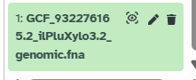
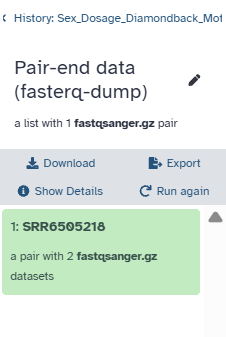
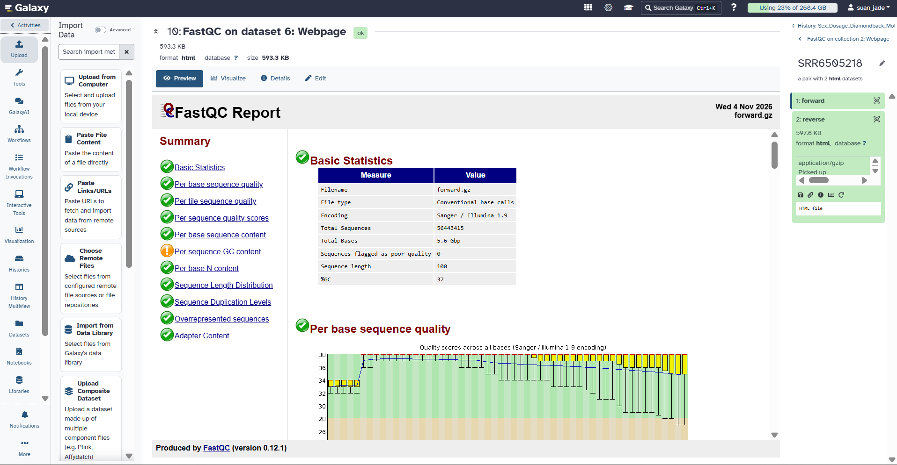
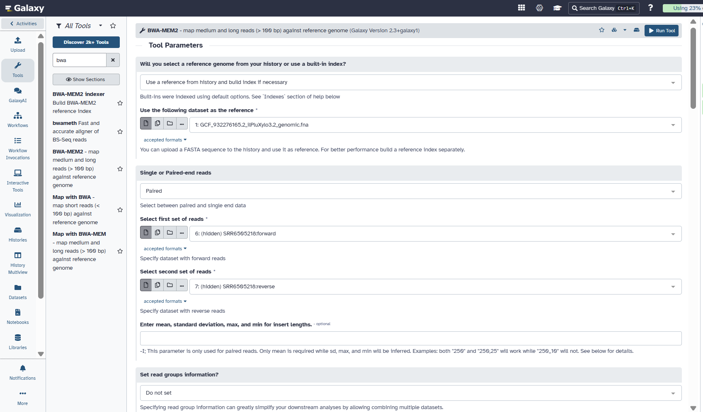
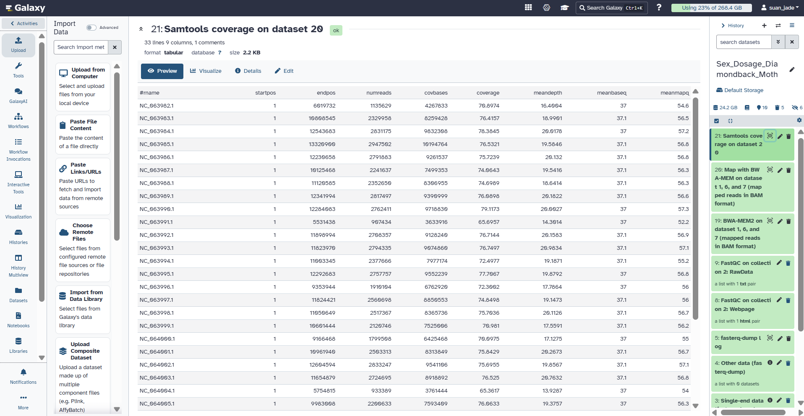
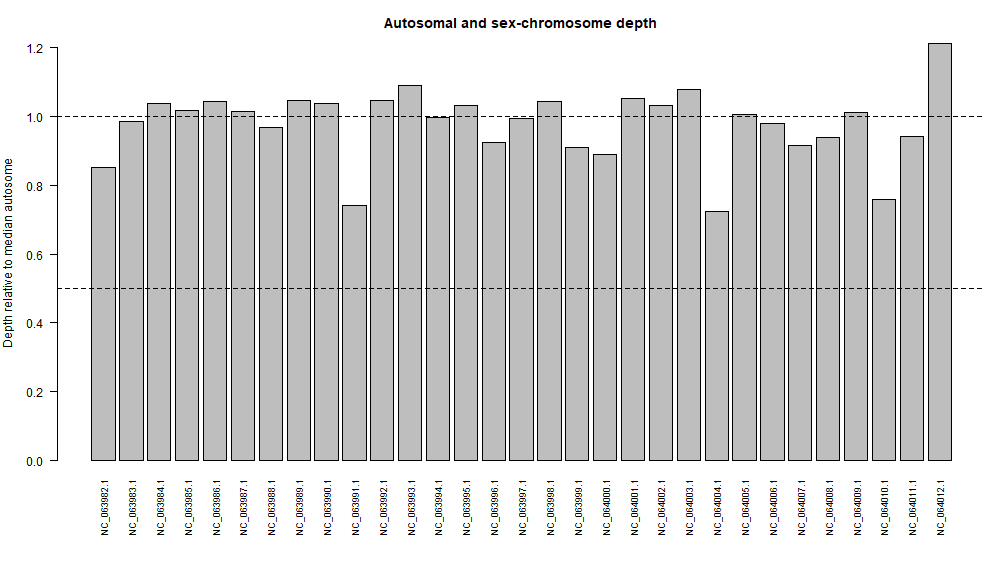
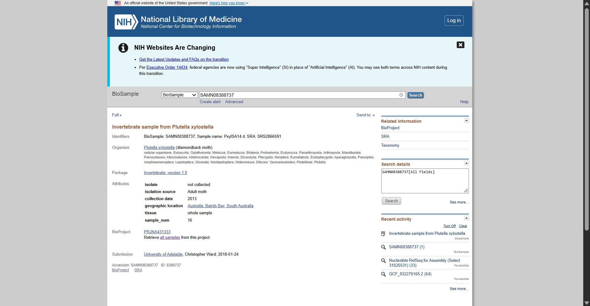

# Sex-Chromosome Dosage Analysis in *Plutella xylostella* (Diamondback Moth)
**Using NCBI, Galaxy, and R**

---

## Project Information
| Item | Details |
|---|---|
| **Title** | Sex-Chromosome Dosage in *Plutella xylostella* (Diamondback Moth) Using NCBI, Galaxy, and R |
| **Course** | Cell and Molecular Biology — Individual Practical Exercise |
| **Student** | Jade Angela Suan |
| **Section** | B |
| **Date** | 2026-11-09 |
| **BioSample** | SAMN08388737 |
| **BioProject** | PRJNA431333 |
| **Sex System** | ZZ/ZW |

---

## 1. Selected Species and Study Question

### Species
*Plutella xylostella* (diamondback moth), Order Lepidoptera.
Sex determination system: **ZZ/ZW** — female-heterogametic (ZW = female; ZZ = male).

### Study Question
Does the whole-genome sequencing (WGS) read depth on the Z chromosome, relative to the autosomes, indicate that the individual that supplied the reads carries **two Z copies (ZZ-like)** or **one Z copy (ZW-like)**?

### Approach
1. WGS reads are mapped to a chromosome-level reference genome.
2. Mean read depth per chromosome is calculated using **Samtools coverage**.
3. The ratio of Z chromosome depth to the **median autosome depth** is computed in **R**.
4. Under a standard ZZ/ZW system:
   - **Z:A ≈ 1.0** - consistent with **ZZ** (two copies, male)
   - **Z:A ≈ 0.5** - consistent with **ZW** (one copy, female)

---

## 2. Accessions and Links

| Item | Accession / Details | Link |
|---|---|---|
| Assembly (RefSeq) | GCF_932276165.2 (iPluXylo3.2) | https://www.ncbi.nlm.nih.gov/datasets/genome/GCF_932276165.2/ |
| Assembly level | Chromosome | https://www.ncbi.nlm.nih.gov/datasets/genome/GCF_932276165.2/ |
| Assembly BioSample | SAMEA7520369 | https://www.ncbi.nlm.nih.gov/biosample/SAMEA7520369/ |
| WGS run | SRR6505218<br />(Illumina HiSeq 2000, WGS, paired) | https://www.ncbi.nlm.nih.gov/sra/SRR6505218 |
| WGS BioSample | SAMN08388737 | https://www.ncbi.nlm.nih.gov/biosample/SAMN08388737 |
| WGS BioProject | PRJNA431333 | https://www.ncbi.nlm.nih.gov/bioproject/PRJNA431333 |
| Z chromosome (RefSeq/GenBank) | NC_064012.1 / OW026553.1 | https://www.ncbi.nlm.nih.gov/datasets/genome/GCF_932276165.1/ |

Same donor? No. The assembly is from a male collected at Wytham Great Wood, United Kingdom (2019). The reads come from an adult moth collected at Bairds Bay, South Australia (2013). The result therefore refers to the WGS donor only.

---

## 3. Methods: Exact Galaxy Steps

### Galaxy Environment
| Item | Details |
|---|---|
| **Server** | https://usegalaxy.org |
| **History Name** | Sex_Dosage_Diamondback_Moth |
| **Shared History Link** | https://galaxy-main.usegalaxy.org/u/suan_jade/h/sex-dosage-diamondback-moth |
| **Workflow Link** | https://galaxy-main.usegalaxy.org/published/workflow?id=7c07905e02428af1 |

---

### Reference Genome
- Downloaded `GCF_932276165.2_ilPluXylo3.2_genomic.fna` and the chromosome sequence report from **NCBI Datasets** for assembly **GCF_932276165.2** (*Plutella xylostella* iPluXylo3.2).
- Uploaded the FASTA file to Galaxy → **Dataset 1** (datatype: `fasta`).


**Screenshot 1.** Reference genome FASTA file uploaded to Galaxy as Dataset 1.

---

### Sequencing Reads
- Imported **SRR6505218** using the Galaxy tool:  
  **Fasterq-dump: Download and Extract Reads in FASTQ**
- Output: **Paired-end collection** (`fastqsanger.gz`)
  - Forward reads: 56,443,415 sequences
  - Reverse reads: 56,443,415 sequences
  - Read length: 100 bp
  - Single-end / other outputs: empty


**Screenshot 2.** SRR6505218 imported via Fasterq-dump — paired-end collection created.

---

### Quality Control — FastQC
- Tool: **FastQC** — run on paired collection, default settings
**Forward Reads:**


**Screenshot 3.** FastQC report — forward reads.

**Reverse Reads:**


**Screenshot 4.** FastQC report — reverse reads.

**Results:**
  - 0 sequences flagged as poor quality
  - %GC: 37%
  - Per-base quality, per-tile quality, quality scores, per-base content, N content - **PASS**
  - No overrepresented sequences; adapter content negligible
  - Per-sequence GC content - **Warning** (see Limitations section)
  - No trimming/filtering applied

---

### Read Alignment — BWA‑MEM2
- Tool: **BWA‑MEM2**
- Reference: Dataset 1 (FASTA from history - index built on‑the‑fly)
- Input reads:
  - Forward: SRR6505218 forward
  - Reverse: SRR6505218 reverse
- Mode: paired‑end; default parameters
- **Output:** Dataset 19 — aligned BAM, 8.2 GB
  - Sorting mode: **Sort by chromosomal coordinates**
  - Analysis mode: `illumina`
- **Note:** Two prior BWA‑MEM2 attempts failed (remote server error / queued indefinitely); BWA‑MEM2 completed successfully.


**Screenshot 5.** BWA‑MEM2 tool settings — reference genome and paired‑end input reads.

---

### Coverage Calculation — Samtools Coverage
- Tool: **Samtools Coverage**
- Input: Dataset 19 (sorted BAM)
- Parameters:
  - Pooling: **No**
  - Output: Tabular (histogram = No)
  - Minimum mapping quality: **20**
  - Minimum base quality: **20**
  - Minimum read length: **0**
  - Exclusions: unmapped, not primary alignment, fails vendor quality, PCR/optical duplicates
- **Result:** Dataset 21 — 33 rows × 9 columns
  - Downloaded → renamed: `chromosome_coverage.tsv`
  - Individual sample only — **not pooled**

**Screenshot 6.** Samtools Coverage results table — 33 chromosomes × 9 columns.
---

## 4. Chromosome Groups and Rationale

**File:** `chromosome_groups.csv`

| Group | Sequences / Accessions | Reason |
|---|---|---|
| **A** (Autosomes) | NC_063982.1 – NC_064011.1<br />(30 chromosomes, numbered 2–31) | Numbered chromosomes from the ilPluXylo3.2 chromosome-level assembly; listed in the NCBI Datasets chromosome table. All 30 were used to produce a stable median autosome depth. |
| **Z** | NC_064012.1 | Listed as **chromosome Z** in the NCBI chromosome table (GenBank: OW026553.1; length: 16,174,618 bp). The RefSeq record includes the qualifier `/chromosome="Z"`. |
| **W** | None labelled | No W chromosome appears in the assembly's chromosome table. |

### Excluded from Analysis
- **Mitochondrion** — OW026584.2 (no RefSeq accession; absent from the coverage table)
- **Unplaced scaffolds** — NW_028138350.1, NW_028138351.1

### Rationale for Group Selection
- Chromosome numbering in this assembly starts at **2**, so the minimum requirement of five autosomes was far exceeded (n = 30).
- Using **all 30 autosomes** rather than a subset produces a more robust, stable estimate of median autosome depth, reducing noise in the Z/A ratio calculation.
- Unplaced contigs and the mitochondrion were excluded — they do not represent nuclear chromosomes and would distort dosage comparisons.

---

## 5. Input Coverage Table (from Samtools Coverage)

**Full file:** `chromosome_coverage.tsv`

| rname | Group | End Position (bp) | Mean Depth |
|---|---|---:|---:|
| NC_063982.1 | A | 6,019,732 | 16.4004 |
| NC_063983.1 | A | 10,808,545 | 18.9901 |
| NC_063984.1 | A | 12,543,683 | 20.0178 |
| NC_063985.1 | A | 13,320,900 | 19.5846 |
| NC_063986.1 | A | 12,230,658 | 20.1320 |
| NC_063987.1 | A | 10,125,468 | 19.5416 |
| NC_063988.1 | A | 11,120,585 | 18.6414 |
| NC_063989.1 | A | 12,341,994 | 20.1822 |
| NC_063990.1 | A | 12,284,083 | 20.0027 |
| NC_063991.1 | A | 5,531,438 | 14.3014 |
| NC_063992.1 | A | 11,898,994 | 20.1583 |
| NC_063993.1 | A | 11,823,970 | 20.9834 |
| NC_063994.1 | A | 11,003,345 | 19.1871 |
| NC_063995.1 | A | 12,292,683 | 19.8792 |
| NC_063996.1 | A | 9,353,944 | 17.7864 |
| NC_063997.1 | A | 11,824,421 | 19.1473 |
| NC_063998.1 | A | 11,050,649 | 20.1126 |
| NC_063999.1 | A | 10,601,444 | 17.5591 |
| NC_064000.1 | A | 9,166,468 | 17.1275 |
| NC_064001.1 | A | 10,961,940 | 20.2673 |
| NC_064002.1 | A | 12,604,594 | 19.8567 |
| NC_064003.1 | A | 11,654,879 | 20.7632 |
| NC_064004.1 | A | 5,754,815 | 13.9287 |
| NC_064005.1 | A | 9,983,008 | 19.3757 |
| NC_064006.1 | A | 8,635,333 | 18.9007 |
| NC_064007.1 | A | 9,082,186 | 17.6296 |
| NC_064008.1 | A | 9,102,773 | 18.0778 |
| NC_064009.1 | A | 11,339,310 | 19.4733 |
| NC_064010.1 | A | 5,994,776 | 14.6311 |
| NC_064011.1 | A | 6,621,544 | 18.1472 |
| **NC_064012.1** | **Z** | **16,174,618** | **23.3724** |
| NW_028138350.1 | excluded | 33,758 | 0.8003 |
| NW_028138351.1 | excluded | 16,223 | 17.6054 |

### Notes
- **33 entries total** — 30 autosomes, 1 Z chromosome, 2 unplaced scaffolds
- **Excluded rows** (below): not used in dosage calculations
- Z chromosome highlighted — used to compute Z/A ratio

---

## 6. R Analysis — Complete Code

**File:** `sex_depth_analysis.R`

### How to Run
Execute from the directory containing both input files:
```bash
Rscript sex_depth_analysis.R
# Sex-chromosome dosage from whole-genome DNA read depth
# Input: Samtools coverage TSV + student chromosome labels

cov <- read.delim(
  "chromosome_coverage.tsv",
  comment.char = "",
  check.names = FALSE,
  stringsAsFactors = FALSE
)
names(cov)[1] <- "rname"   # Accepts the '#rname' header
if (!"meandepth" %in% names(cov)) stop("Missing meandepth column")
key <- read.csv("chromosome_groups.csv", stringsAsFactors = FALSE)
if (!all(c("rname", "group") %in% names(key))) stop("Bad key columns")
key$rname <- trimws(key$rname)
key$group <- toupper(trimws(key$group))
if (anyDuplicated(key$rname)) stop("Repeated rname in key file")
if (!all(key$group %in% c("A", "X", "Y", "Z", "W"))) {
  stop("Use only A, X, Y, Z or W in the group column")
}
x <- merge(key, cov[, c("rname", "meandepth")],
           by = "rname", all.x = TRUE, sort = FALSE)
x$meandepth <- suppressWarnings(as.numeric(x$meandepth))
if (anyNA(x$meandepth)) stop("Missing depths: check rname matches")
if (any(x$meandepth < 0)) stop("Negative depth is not valid")
if (sum(x$group == "A") < 5) stop("Label at least 5 autosomes")
if ("X" %in% x$group && "Z" %in% x$group) {
  stop("Choose either an XY or a ZW species, not both")
}
if (sum(x$group == "X") == 1 && !any(x$group == "Z")) {
  target <- "X"
  one_copy <- "XY-like"
  two_copies <- "XX-like"
} else if (sum(x$group == "Z") == 1 && !any(x$group == "X")) {
  target <- "Z"
  one_copy <- "ZW-like"
  two_copies <- "ZZ-like"
} else {
  stop("Label exactly one X or exactly one Z chromosome")
}
A <- median(x$meandepth[x$group == "A"])
if (!is.finite(A) || A <= 0) stop("No usable autosomal coverage")
x$relative_depth <- x$meandepth / A
ratio <- x$relative_depth[x$group == target]
call <- if (ratio >= 0.80) {
  two_copies
} else if (ratio <= 0.65) {
  one_copy
} else {
  "Ambiguous"
}
if (A < 1) call <- "Inconclusive: very low autosomal depth"

# Additional Y or W evidence can support, but not prove, a call
partner <- if (target == "X") "Y" else "W"
partner_ratio <- if (partner %in% x$group) {
  x$relative_depth[x$group == partner][1]
} else {
  NA_real_
}

# Export results and a simple, reproducible figure
dir.create("results", showWarnings = FALSE)
write.csv(x, "results/chromosome_relative_depth.csv", row.names = FALSE)
png("results/chromosome_depth.png", width = 1000, height = 580)
par(mar = c(8, 4, 3, 1))
barplot(
  x$relative_depth,
  names.arg = x$rname,
  las = 2,
  ylab = "Depth relative to median autosome",
  main = "Autosomal and sex-chromosome depth",
  cex.names = 0.75
)
abline(h = c(0.5, 1.0), lty = 2)
dev.off()
summary_lines <- c(
  paste("Median autosome depth:", round(A, 3)),
  paste(target, "/ A ratio:", round(ratio, 3)),
  paste(partner, "/ A ratio:", round(partner_ratio, 3)),
  paste("Dosage interpretation:", call),
  "Compare with BioSample sex and discuss limitations."
)
writeLines(summary_lines, "results/sex_inference.txt")
cat(paste(summary_lines, collapse = "\n"), "\n")

```
### 7. Results

### Output Files
All results are in the `results/` directory:

| File | Description |
|---|---|
|  `chromosome_relative_depth.csv` | Normalized coverage ratios per chromosome |
|  `chromosome_depth.png` | Bar plot of relative depth per chromosome |
|  `sex_inference.txt` | Text summary and dosage call |

### Key Metrics
| Metric | Value |
|---|---|
| Median autosome depth (30 chromosomes) | 19.281 |
| Z chromosome mean depth (NC_064012.1) | 23.372 |
| **Z:A ratio** | **1.212** |
| W:A ratio | NA (no W chromosome labelled) |
| **Dosage interpretation** | **ZZ‑like** |


Table 1. Chromosome relative depth and coverage ratios.

### Summary Text (`sex_inference.txt`)
Median autosome depth: 19.281
Z / A ratio: 1.212
W / A ratio: NA
Dosage interpretation: ZZ-like
Compare with BioSample sex and discuss limitations.


Text box 1. Final sex-chromosome dosage inference.

### Visualization Description
**Figure: Autosomal and sex‑chromosome depth**
- Bar plot shows coverage normalized to the median autosome depth (dashed reference lines at 0.5 and 1.0)
- Autosomal chromosomes range from approximately **0.72 to 1.09** relative depth
- The Z chromosome bar is the highest at **1.21**, consistent with two copies
- **No chromosome shows depth near 0.5** — the expected range for a single‑copy Z in a ZW female individual
- No W chromosome coverage was detected in this dataset
**chromosome_depth.png**
> Bar plot showing each chromosome's depth normalized to median autosome; dashed lines at 0.5 and 1.0


Figure 1. Autosomal and sex-chromosome depth relative to median autosome.

## 8. Answers to the Six Questions

### 1. Species and Sex‑Determination System
**Chosen species:** *Plutella xylostella* (diamondback moth).

**Evidence for ZZ/ZW:**
- Moths and butterflies (Order Lepidoptera) are female‑heterogametic: males carry **ZZ**, females carry **ZW**.
- The published reference genome assembly (ilPluXylo3.2) is described as 31 chromosomal pseudomolecules — 30 autosomes plus the Z chromosome — from a diploid individual.
- NCBI explicitly identifies NC_064012.1 as **chromosome Z** in the chromosome table and in the RefSeq record qualifier `/chromosome="Z"` (GenBank: OW026553.1).

---

### 2. Accessions and Donor Identity
| Item | Accession |
|---|---|
| Reference assembly | GCF_932276165.2 (ilPluXylo3.2) |
| Assembly BioSample | SAMEA7520369 |
| WGS run | SRR6505218 |
| WGS BioSample | SAMN08388737 |

**Donors are NOT the same:**
- Assembly donor: male from Wytham Great Wood, United Kingdom
- WGS donor: adult moth from Bairds Bay, South Australia
- Cross‑donor comparison is therefore **not valid** — this inference applies only to the sequenced individual.

---

### 3. Chromosome Selection and Verification
| Group | Accessions |
|---|---|
| Autosomes (A) | NC_063982.1 – NC_064011.1 (chromosomes 2–31; 30 total) |
| Z chromosome | NC_064012.1 (GenBank: OW026553.1; length = 16,174,618 bp) |
| Excluded | Mitochondrion (OW026584.2); unplaced scaffolds NW_028138350.1, NW_028138351.1 |

**Verification:**
- Z chromosome identity confirmed in the **NCBI Datasets chromosome table** listing and length match (16,174,618 bp)
- RefSeq record includes `/chromosome="Z"` annotation
- Length matches the value returned in the Samtools coverage output

---

### 4. Coverage Metrics and Inferred Complement
| Metric | Value |
|---|---|
| Median autosomal depth (30 chromosomes) | 19.281 |
| Z chromosome depth | 23.372 |
| **Z:A ratio** | **1.212** |
| W chromosome | Not detected / not labelled |
| **Inferred complement** | **ZZ‑like** (two Z copies → male) |

---

### 5. Comparison with Donor Sex Metadata
- The WGS BioSample (SAMN08388737) **does not record sex** — no metadata comparison is possible.
- **Z:A = 1.212** - consistent with **ZZ** (two copies). A ZW female would show Z:A ≈ 0.5.
- Ratio above 1.0 reflects normal variation in mappability and sequence divergence — call is clear despite slight deviation from exactly 1.0.
- Because assembly and WGS derive from **different individuals**, the result describes **only the sequenced donor** and should not be compared with the assembly donor's sex.

---

### 6. Why a Chromosome‑Level Assembly Alone Is Insufficient
- An assembly represents **one consensus sequence** from one individual — it contains a Z chromosome regardless of whether that individual was ZZ or ZW.
- Chromosome **lengths and presence** reveal nothing about **copy number** in the sample being tested.
- Copy number must be measured from **read depth** of the sequenced individual, normalized against autosomes.
- The reference assembly may also **lack or misassemble** the W chromosome (highly repetitive), making it impossible to identify female samples from the assembly alone.
- Reliable inference requires **reads from the same individual** plus a normalized dosage calculation — not just the reference sequence.


## 9. Limitations

### Z:A Ratio Above 1.0
A ZZ individual is expected to show a Z:A ratio near 1.0; the observed value of **1.212** is elevated. In the coverage table, the shortest chromosomes have the lowest relative depth (~0.72–0.76), while the longest chromosome — Z at 16.2 Mb — has the highest. This pattern suggests **chromosome length, mapping bias, or edge effects** may be contributing to the deviation. This trend was observed but not formally tested.

### No Recorded Sex for Validation
The WGS BioSample (SAMN08388737) does not include a sex field. The dosage call therefore rests **on sequence evidence alone** and could not be validated against independent metadata.


**Screenshot 7.** NCBI BioSample record for SAMN08388737 — donor metadata shows collection location, date, and tissue type; **no sex field recorded**.


### Assembly and WGS Derive from Different Donors
- **WGS donor:** Bairds Bay, South Australia, 2013
- **Assembly donor:** Wytham Great Wood, United Kingdom, 2019
- The individuals are from **different populations and collection years**, so sequence divergence may introduce mapping bias. The result applies **only to the sequenced WGS donor** and cannot be cross‑validated against the assembly.

### W Chromosome Absence from Reference
No W chromosome is listed in the assembly's chromosome table → W:A ratio is NA. **Absence from the assembly is not proof of biological absence** in the sample; the W may be unassembled or highly repetitive.

### Single Sample, Single Run
- Analysis based on **one WGS run** (SRR6505218): 56.4 million paired‑end read pairs (~35× coverage)
- Source described as an **adult moth, whole organism** — no biological replicates included

### FastQC GC Content Warning
Per‑sequence GC content produced a warning in both forward and reverse read files. This may indicate **contaminating or non‑target DNA** in the whole‑insect sample. Such reads would fail to map to the *Plutella xylostella* reference, but this effect was not quantified.

### Thresholds Are Teaching Guidelines
The cutoffs used (≥ 0.80 = two copies; ≤ 0.65 = one copy) are **classroom reference values**, not validated diagnostic thresholds. Additional factors including Z‑linked repeats, pseudoautosomal regions, and reference sequence errors can also distort dosage ratios.

## 10. References

- NCBI Datasets genome — *Plutella xylostella* assembly GCF_932276165.2
  https://www.ncbi.nlm.nih.gov/datasets/genome/GCF_932276165.2/

- NCBI SRA run SRR6505218
  https://www.ncbi.nlm.nih.gov/sra/SRR6505218

- Genome publication: *The genome sequence of the Diamondback Moth, Plutella xylostella* (Linnaeus, 1758)
  https://pubmed.ncbi.nlm.nih.gov/38779055/

- Ward CM, Baxter SW. Assessing genomic admixture between cryptic *Plutella* moth species following secondary contact. *Genome Biol Evol* 2018; source of the WGS data series.
  https://academic.oup.com/gbe/article/10/11/2973/5129086

- Galaxy platform
  https://usegalaxy.org

- Samtools coverage documentation
  https://www.htslib.org/doc/samtools-coverage.html

- Sex-chromosome coverage review
  https://pmc.ncbi.nlm.nih.gov/articles/PMC6900093/

- Galaxy NGS training material — Introduction to NGS data management
  https://training.galaxyproject.org/training-material/topics/introduction/tutorials/galaxy-intro-ngs-data-managment/tutorial.html
